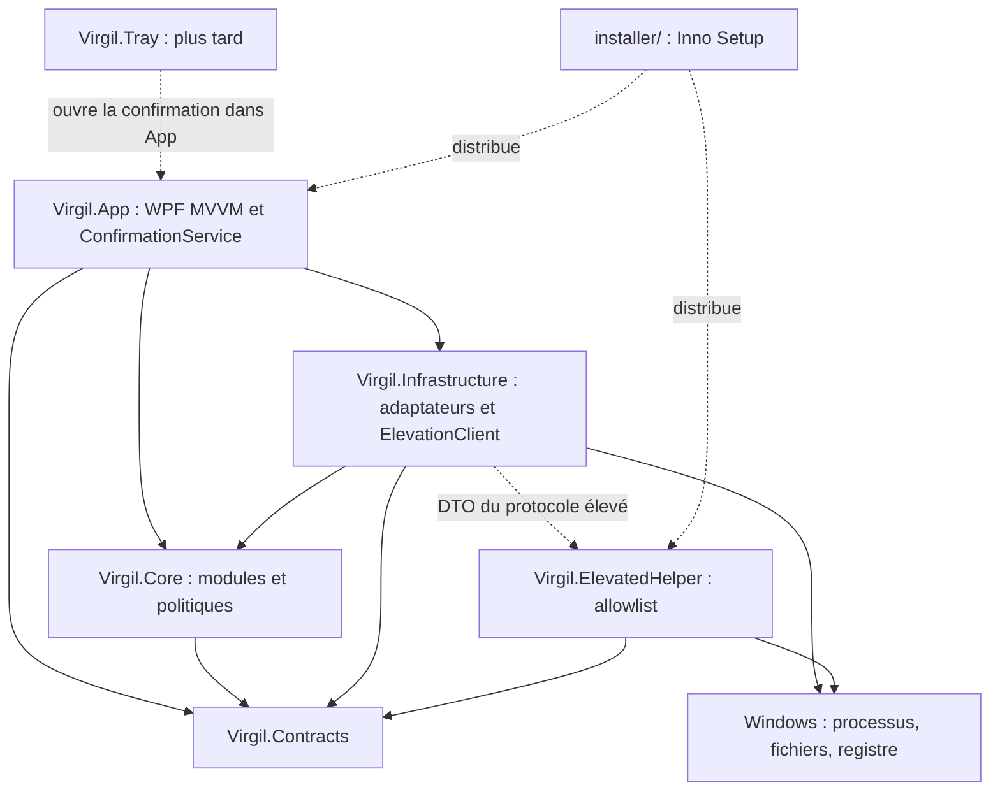

# Virgil 2.0 — Architecture

Ce document est la source de vérité pour l’architecture. Il distingue l’existant de la cible ; les documents de modules historiques ne prouvent pas qu’une capacité est livrée. La phase 0a ne modifie aucun code C# ni aucune dépendance.

## État actuel vérifié

Le sous-lot 0e-1 livre `RiskLevel`, `ConfirmationLevel`, `Reversibility`, `ActionPreview`, `ActionResult` et les résultats de validation dans `Contracts/Actions`. `ConfirmedPlan` reste dans `Core/Actions` (constructeur interne, identité vérifiée en mémoire) : un DTO désérialisable ne vaut jamais consentement. `ConfirmationService` et sa porte unique `IConfirmedPlanGate` sont disponibles, testés et enregistrés comme une même instance Singleton via Hosting. Le sous-lot 0e-2 livre les correspondances pures des quatre enums dans `RiskLevelMapping`, la purge monotone du registre (au-delà de validité + MaximumLifetime, plafond de 1024 émissions, retrait des plus anciennes) et le pilote Applications. Après les dialogues et la politique existants, le VM émet le plan ; le service reconstruit l’aperçu validé et le consomme avant le lanceur. Aucun dialogue ni texte existant ne change. Le sous-lot 0e-3 (PR #44) branche Ressources et Mises à jour : émission après Execute de chaque overlay existant, gardes et identité avant TryConsume, puis effet OS. Les aperçus processus lient PID, nom, chemin et heure de démarrage, sans CPU ni mémoire ; ceux des mises à jour lient les versions, la source et la commande prévisualisée, indépendamment du WinGet détecté à l’exécution. Le sous-lot 0e-4 (PR #45) branche Interventions et Nettoyage : les cinq modules passent désormais par la porte. Le nettoyage conserve son drapeau indépendant `RequiresReinforcedConfirmation`, y compris pour certaines zones Medium : la correspondance d’enum seule ne remplace pas cette exigence.

Le sous-lot 0d-9 extrait `ApplicationsViewModel`, `ApplicationItemViewModel` et les cartes texte typées : inventaire, recherche/filtre, détail individuel, restes en lecture seule, désinstallation officielle et rapports sans type WPF dans les ViewModels. Le VM et le dialogue `IApplicationUninstallConfirmationDialog` sont Singleton par factories explicites ; la vue conserve les relais, le focus différé, le curseur et les noyaux animés. Les gardes et confirmations explicite puis renforcée précèdent toujours le lancement, uniquement depuis le détail. 0d-9 livré (PR #41) ; toutes les vues de modules sont sous ViewModel, lot 0d terminé ; 0e à 0g à réaliser.

Le lot 0d-8 extrait `UpdatesViewModel` et `UpdateItemViewModel` : scan, inventaire pilotes, sélection, décisions Execute/Skip/CancelAll, ouverture manuelle Windows Update et rapports sans dépendance WPF. Le VM est Singleton par factory explicite ; la vue conserve les relais, le focus différé, le curseur et les noyaux animés. Aucune exécution ni ouverture sans décision Execute pour l’élément courant. 0d-8 livré (PR #40) ; lot 0d terminé avec 0d-9 (PR #41), puis 0e à 0g à réaliser.

Le sous-lot 0d-7 extrait `CleanupViewModel` et les cartes typées : analyse, parcours par zone, décisions Execute/Skip/CancelAll, état observable, rapports et persistance sans dépendance WPF. `CleanupView` utilise le VM Singleton par factory explicite ; elle conserve les relais, le focus différé après les bindings, le curseur et les animations. L’exécution reste accessible uniquement après Execute pour la zone courante, avec les services et protections de nettoyage inchangés. Le lot 0d-7 est livré (PR #39).

Le lot 0d-6 extrait `InterventionsViewModel` et `InterventionItemViewModel` sur le modèle `ResourcesViewModel` : diagnostic, sélection, parcours guidé, confirmation par état observable et persistance des rapports sans dépendance WPF. Le VM est Singleton par factory explicite ; InterventionsView conserve les relais publics, le focus, le curseur et l’animation. Les décisions Execute/Skip/CancelAll et l’attente des actions critiques restent celles du parcours existant. Le branchement ConfirmedPlan est livré en 0e-4 (PR #45).

Le lot 0d-5 extrait `ResourcesViewModel` et `ProcessResourceItemViewModel` selon le modèle 0d-4 : état observable, commandes, analyse, actions et persistance sans dépendance WPF. La confirmation ressources est un état du VM (overlay et décision Execute/Skip/CancelAll) : fermeture propre et relance Explorer exigent une validation simple, fermeture forcée une validation renforcée ; les autres actions gardent leur comportement. Le VM est Singleton par factory explicite ; la vue conserve uniquement relais, focus, défilement, curseur et animation. Les contrats de confirmation sont livrés en 0e-1 ; leur branchement Ressources est livré en 0e-3 (PR #44), sans changer cet overlay.

CommunityToolkit.Mvvm 8.2.2 est utilisé dans App pour le premier `ReportsHistoryViewModel` (0d-4), modèle des lots suivants : état observable et commandes sans dépendance WPF, services injectés, cartes via ItemsControl. `IFileSaveDialog` isole le dialogue de sauvegarde WPF. Le ViewModel et le dialogue sont Singleton par factories explicites ; la vue conserve les relais publics, le focus, le défilement et l’état du mini noyau.

L’instance unique utilise le mutex `Local\Virgil.SingleInstance.v2` et un événement AutoReset local pour activer la fenêtre existante. Le contrôle précède chemins, settings, logs et host ; une seconde instance signale puis quitte sans les créer. Le mutex reste acquis jusqu’à la fin de la sortie sur le thread UI. Le manifeste App déclare `asInvoker`, Windows 10/11 et `PerMonitorV2` (`true/PM`). Les warnings sont traités en erreurs, sans exclusion anticipée NuGet. Si le dossier de logs est inaccessible (IO, droits ou sécurité), le démarrage continue avec un logger sans sink.

La solution `Virgil.sln` contient six projets :

| Projet | Réalité du dépôt |
| --- | --- |
| `src/Virgil.App` | Application WPF .NET 8 Windows x64, fenêtre principale, vues Nettoyage, Mises à jour, Applications, Interventions, Ressources et Historique des rapports, contrôle animé Virgil. Composition Hosting/DI dans App, services injectés et vues sans construction directe de services. ReportsHistoryView, ResourcesView, InterventionsView, CleanupView, UpdatesView et ApplicationsView utilisent des ViewModels ; les vues conservent les relais et les comportements WPF. |
| `src/Virgil.Infrastructure` | .NET 8 Windows (`net8.0-windows`), référence Core et Contracts, contient l’unique `ProcessRunner` de l’application. |
| `src/Virgil.Core` | Services de diagnostic, monitoring, ressources/processus, nettoyage, mises à jour winget/Windows, inventaire/désinstallation d’applications, interventions et rapports. Contient aussi les accès Windows, fichiers, registre, processus et le client du helper : la séparation métier/OS reste à faire. Référence Contracts. |
| `src/Virgil.Contracts` | .NET 8 (`net8.0`), sans référence de projet ni de package : modèles partagés de scan, santé système, nettoyage, mises à jour, applications, ressources, interventions, rapports et DTO du protocole élevé. Plusieurs enums de risque encore propres aux modules ; `ScanRules` encore présent. |
| `src/Virgil.ElevatedHelper` | Exécutable Windows séparé, requêtes/résultats via fichiers, validation du contexte et des chemins, allowlist de commandes, écriture atomique des résultats. Référence actuellement Core et Contracts. |
| `tests/Virgil.Tests` | Tests xUnit : scan/règles, nettoyage et sécurité, mises à jour, applications/inventaire/désinstallation/résidus, ressources, interventions, rapports, protocole élevé et animation. Référence Core, Contracts, Infrastructure, ElevatedHelper et App. |

Les modèles d’animation sont dans `Virgil.App/Animation` (namespace `Virgil.App.Animation`).

App compose les services via `Microsoft.Extensions.Hosting` 8.0.1, sans configuration ni logging par défaut. Le conteneur valide la construction et les scopes ; le runner et les vues sont Singleton, les services Core Transient (une instance par consommateur). Le host démarre avant la fenêtre et est arrêté puis libéré à la sortie. App référence Core, Contracts et Infrastructure ; sa référence au helper sert à sa construction/publication (`ReferenceOutputAssembly=false`). Le helper est publié avec App.

Les gardes existants incluent `CleanupPathGuard`, `CleanupSafetyClassifier`, `ProcessProtectionPolicy` et `ElevatedActionAllowlist`. Les confirmations restent spécifiques aux modules ; la désinstallation Applications exige désormais un `ConfirmedPlan` et conserve sa politique explicite/renforcée. La surcharge `bool userConfirmed` est supprimée. Le nettoyage vérifie ses aperçus mais utilise encore `File.Delete` pour toutes les zones sauf la corbeille, traitée via l’API Windows : la quarantaine généralisée n’est pas livrée. Les paramètres bool de confirmation, dont `bool reinforcedConfirmation`, sont supprimés de `IProcessActionService` ; les actions destructives exigent un `ConfirmedPlan`. `ReleaseInactiveMemory` (information seule) et `OpenLocation` (non destructif) acceptent un plan null sans nouveau dialogue. `IUpdateExecutionService.ExecuteAsync` exige également un plan, sans surcharge de contournement ; Windows Update reste inchangé. Le port unique `IProcessRunner` (`Core/Processes`) est implémenté dans Infrastructure ; `ShellApplicationProcessLauncher` et `ElevatedProcessLauncher` sont devenus des adaptateurs. `IProcessRunner` est injecté depuis la composition App ; le défaut statique a été supprimé. Tous les lancements de l’application passent par `IProcessRunner` (Infrastructure), avec le test d’architecture `ProcessLaunchArchitectureTests`. `ElevatedCommandRunner` est conservé dans le helper par conception. L’historique stocke déjà des rapports JSON locaux.

`Virgil.Tray` et `installer/` n’existent pas encore. Il n’existe pas encore de contrat commun `IMaintenanceModule`/`IMaintenanceAction`. Le `ConfirmedPlan` commun et le `ConfirmationService` central sont livrés en 0e-1 ; Applications est branché en 0e-2, Ressources et Mises à jour en 0e-3 ; Interventions et Nettoyage sont branchés en 0e-4 (PR #45) ; lot 0e terminé, 0f à réaliser. Les vues de modules ont terminé leur migration MVVM (0d). Les points de restauration et sauvegardes du démarrage décrits ci-dessous sont des exigences cibles.

La journalisation Serilog écrit des fichiers quotidiens dans `%LOCALAPPDATA%\Virgil\logs` (14 fichiers, rotation à 10 Mo). Les settings JSON sont dans `%APPDATA%\Virgil\settings.json`, à côté des rapports, chargés avant le logger et enregistrés atomiquement. Un fichier invalide reste intact avec des valeurs par défaut. Les avertissements passent par un callback Infrastructure adapté vers `ILogger` dans App.

Le gestionnaire global journalise les exceptions Dispatcher en Error puis notifie et les marque traitées ; les exceptions AppDomain en Fatal puis notifie et vide les logs ; les tâches non observées en Warning sans popup puis les marque observées. Seuls le type et la pile sont journalisés : aucun message d’exception susceptible de contenir du contenu utilisateur ou un secret. Les services métier ne sont pas encore instrumentés. Le démarrage synchrone suit chemins → settings → logger → abonnements → host → fenêtre ; un échec affiche le message dédié puis ferme avec le code 1.

La CI de référence est `.github/workflows/build.yml`, sur `windows-latest` : restore, build Release, tests, publication self-contained win-x64 et artefact. Elle ne produit pas encore d’installateur.

Les fabriques pures `InterventionActionPreviewFactory` et `CleanupActionPreviewFactory` reconstruisent les aperçus au service. Interventions lie l’identité et la définition stable (catégorie, droits, risque source), sans diagnostic volatil. Nettoyage lie la zone, la date UTC de l’aperçu et les chemins, tailles et dates UTC des candidats éligibles dans leur ordre ; la corbeille lie le nombre et les octets estimés. Le risque nettoyage est le maximum du mapping et du drapeau renforcé (zones avancées Medium et corbeille compris). Un plan est émis par élément après Execute de l’overlay existant ; refus d’émission suit CancelAll. Aucun dialogue ni libellé ne change.

Interventions vérifie disponibilité puis prise en charge locale/droits avant TryConsume et helper ou relance Explorer. Nettoyage vérifie annulation, zone exécutable et validité de l’aperçu (10 minutes) avant TryConsume puis suppression/corbeille ; CleanupPathGuard et CleanupSafetyClassifier restent appliqués par fichier après la porte. `ICleanupService` (aperçu) et `CleanupPermissionRepairService.Assess` (lecture seule) restent hors porte. `IExplorerRestarter` reste un adaptateur interne sans plan, utilisé uniquement par ProcessActionService et InterventionExecutionService après consommation de leur porte (test d’architecture). Le helper, son protocole et son allowlist restent inchangés ; 0f reste à réaliser.

## Architecture cible

| Composant | Responsabilité et dépendances |
| --- | --- |
| `Virgil.Contracts` | Modèles partagés, contrat de module/action, résultats et DTO du protocole élevé. Aucune dépendance WPF, OS ou aux autres projets Virgil. |
| `Virgil.Core` | Logique des modules, orchestration et politiques de sécurité ; ports nécessaires au métier. Référence Contracts uniquement. Aucun appel OS direct. |
| `Virgil.Infrastructure` | Adaptateurs Windows, fichiers, registre, réseau et processus ; une seule abstraction `IProcessRunner` et son implémentation centralisée, sans runners concurrents par module. Logs Serilog dans `%LOCALAPPDATA%\Virgil\logs`, settings JSON, stockage des rapports et `ElevationClient`. Référence Core et Contracts, implémente les ports. |
| `Virgil.App` | WPF MVVM avec CommunityToolkit.Mvvm ; composition DI via Microsoft.Extensions.Hosting. Vues minces, ViewModels injectés, `ConfirmationService` pour les interactions de consentement. Référence Contracts/Core et Infrastructure au point de composition. |
| `Virgil.ElevatedHelper` | Exécutable minimal privilégié. Parmi les projets Virgil, référence seulement Contracts ; conserve ses validations, son allowlist et son exécution locale strictement bornée. Ne charge ni Core, ni Infrastructure, ni App. |
| `Virgil.Tray` (plus tard) | Agent de barre des tâches, notifications et ouverture de l’application. N’agit jamais seul et ne contourne pas ConfirmationService. |
| `installer/` | Scripts Inno Setup pour distribuer App et le helper avec la publication self-contained. |

Les types partagés utiles de Domain seront migrés vers Contracts ; les modèles d’animation vont dans App ; Domain est transitoire, pas une couche supplémentaire de la cible. Les politiques restent dans Core, les effets Windows passent par Infrastructure. Le helper est la frontière privilégiée séparée : son exécuteur interne reste limité à l’allowlist, sans ouvrir un lanceur arbitraire.



Les flèches pleines entre projets représentent les dépendances ; les pointillés représentent les échanges ou la distribution.

## Contrat commun cible

Notation de contrat, à implémenter dans les phases suivantes (les opérations asynchrones acceptent un CancellationToken) :

```text
IMaintenanceModule
  Id, Title, Category
  ScanAsync -> Findings

IMaintenanceAction
  Id, RiskLevel, RequiresAdmin, RebootRequired, Reversibility
  PreviewAsync -> ActionPreview
  ExecuteAsync(ConfirmedPlan) -> ActionResult

RiskLevel = Info | Low | Sensitive | Critical
```

`Findings` décrit les constats et actions proposées sans modification du système. `ActionPreview` décrit précisément l’action, ses cibles, paramètres, effets, risques, droits, redémarrage, réversibilité et sauvegardes nécessaires. `ActionResult` décrit résultat, erreurs, effets réels et éléments de restauration. Une réversibilité partielle ou impossible doit être annoncée explicitement.

Un seul `RiskLevel` remplace les classifications divergentes. Il se mappe aux trois niveaux de popup :

| RiskLevel | Popup de confirmation |
| --- | --- |
| Info, Low | Niveau 1 : confirmation simple, effets et périmètre visibles. Un constat Info en lecture seule n’exige pas de popup d’exécution. |
| Sensitive | Niveau 2 : avertissement détaillé, conséquences et sauvegarde/restauration présentées, accord explicite. |
| Critical | Niveau 3 : confirmation renforcée avec saisie explicite liée à l’action et à sa cible. |

`RequiresAdmin` reste indépendant du risque ; l’UAC ne remplace pas le consentement dans Virgil.

## Confirmation liée à l’aperçu

Seul `ConfirmationService` peut créer un `ConfirmedPlan`, après l’accord explicite correspondant au risque. Un constructeur public ou la désérialisation d’un DTO ne doit pas permettre de fabriquer un consentement valide. En 0e-1, `Issue` refuse un consentement insuffisant par `ConfirmationRefusedException` (`InsufficientConsent`). Le texte critique exact vient de `ExpectedCriticalText(preview)` et lie l’action à sa première cible. La validité par défaut est de 10 minutes ; une durée non positive ou supérieure à 15 minutes est refusée. `Validate` contrôle dans cet ordre : Missing, UnknownProvenance, ActionMismatch, PreviewHashMismatch, Expired (borne incluse), AlreadyUsed. `TryConsume` effectue cette validation et marque l’usage unique atomiquement ; toute future action destructive devra passer cette porte avant un effet OS.

Le plan porte l’identité de l’action, le hash d’une représentation canonique de l’aperçu (cibles, paramètres et conséquences compris), son émission et son expiration. La durée de validité est bornée et contrôlée avec une horloge testable.

`ExecuteAsync` valide le plan avant tout effet OS : provenance, identité, hash, expiration et conformité du périmètre aux conditions présentes. Un plan expiré, forgé, absent ou non conforme est refusé. Toute modification de sélection, de paramètres ou de cible invalide l’accord et impose un nouvel aperçu puis une nouvelle confirmation. Les préconditions et les gardes sont revérifiés au moment d’agir ; un refus ne produit aucun effet destructif.

Ce mécanisme a remplacé le paramètre `bool userConfirmed` de la désinstallation Applications en 0e-2, sans supprimer prématurément les confirmations et gardes actuels pendant la migration. Le protocole élevé transporte uniquement une requête bornée issue du plan validé ; le helper revérifie indépendamment identité, chemins, fraîcheur et allowlist. Le hash assure le lien avec l’aperçu, pas à lui seul l’authenticité d’une requête.

## Filets de sécurité obligatoires

- Nettoyer vers une quarantaine ou la corbeille, avec traçabilité et procédure de restauration. Ne pas basculer silencieusement en suppression définitive si ce mécanisme échoue ; toute purge irréversible est une action distincte avec aperçu et confirmation adaptés.
- Créer et vérifier un point de restauration uniquement avant les changements système : pilotes, réparations Windows via le helper, modifications du démarrage, du registre ou des services. Il n’est pas requis pour le nettoyage, protégé par quarantaine/corbeille, ni pour les actions sur les processus. Si la restauration système est désactivée ou limitée, expliquer la situation et proposer de l’activer ; ne permettre de continuer sans cette protection que via une confirmation de niveau Critique indiquant explicitement « aucun point de restauration ». Ne jamais ignorer cette situation en silence. Hors de cette dérogation explicite, un échec de création ou de vérification bloque le changement système.
- Sauvegarder l’état du démarrage avant toute modification et fournir une restauration testée ; bloquer la modification si la sauvegarde échoue.
- Conserver ou renforcer `CleanupPathGuard`, `CleanupSafetyClassifier`, `ProcessProtectionPolicy` et l’allowlist du helper. Aucun texte libre du chat ne devient une commande OS arbitraire.
- Tester toute action destructive, y compris le refus d’un plan expiré/non conforme et l’absence d’effets après refus. Journaliser consentement, exécution, résultat et échec sans exposer de secrets.

## Migration

La [roadmap](ROADMAP.md) fixe les phases et leurs critères de sortie. La phase 0 construit les fondations sans nouvelle fonctionnalité ; la phase 1 migre Diagnostic et Nettoyage sur le contrat commun. Les capacités déjà présentes restent soumises à leurs protections tant que leur migration n’est pas validée. La présente documentation n’atteste ni l’implémentation de la cible ni un build réussi.
