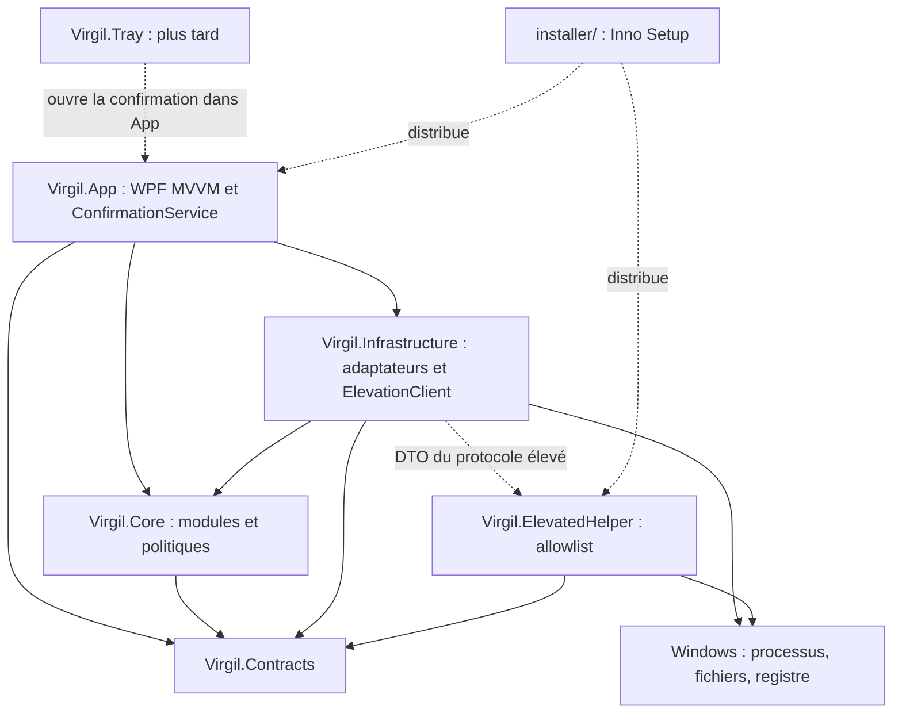

# Virgil 2.0 — Architecture

Ce document est la source de vérité pour l’architecture. Il distingue l’existant de la cible ; les documents de modules historiques ne prouvent pas qu’une capacité est livrée. La phase 0a ne modifie aucun code C# ni aucune dépendance.

## État actuel vérifié

Le sous-lot 0e-1 livre `RiskLevel`, `ConfirmationLevel`, `Reversibility`, `ActionPreview`, `ActionResult` et les résultats de validation dans `Contracts/Actions`. `ConfirmedPlan` reste dans `Core/Actions` (constructeur interne, identité vérifiée en mémoire) : un DTO désérialisable ne vaut jamais consentement. `ConfirmationService` et sa porte unique `IConfirmedPlanGate` sont disponibles, testés et enregistrés comme une même instance Singleton via Hosting. Le sous-lot 0e-2 livre les correspondances pures des quatre enums dans `RiskLevelMapping`, la purge monotone du registre (au-delà de validité + MaximumLifetime, plafond de 1024 émissions, retrait des plus anciennes) et le pilote Applications. Après les dialogues et la politique existants, le VM émet le plan ; le service reconstruit l’aperçu validé et le consomme avant le lanceur. Aucun dialogue ni texte existant ne change. Le sous-lot 0e-3 (PR #44) branche Ressources et Mises à jour : émission après Execute de chaque overlay existant, gardes et identité avant TryConsume, puis effet OS. Les aperçus processus lient PID, nom, chemin et heure de démarrage, sans CPU ni mémoire ; ceux des mises à jour lient les versions, la source et la commande prévisualisée, indépendamment du WinGet détecté à l’exécution. Le sous-lot 0e-4 (PR #45) branche Interventions et Nettoyage : les cinq modules passent désormais par la porte. Le nettoyage conserve son drapeau indépendant `RequiresReinforcedConfirmation`, y compris pour certaines zones Medium : la correspondance d’enum seule ne remplace pas cette exigence.

Le sous-lot 0d-9 extrait `ApplicationsViewModel`, `ApplicationItemViewModel` et les cartes texte typées : inventaire, recherche/filtre, détail individuel, restes en lecture seule, désinstallation officielle et rapports sans type WPF dans les ViewModels. Le VM et le dialogue `IApplicationUninstallConfirmationDialog` sont Singleton par factories explicites ; la vue conserve les relais, le focus différé, le curseur et les noyaux animés. Les gardes et confirmations explicite puis renforcée précèdent toujours le lancement, uniquement depuis le détail. 0d-9 livré (PR #41) ; toutes les vues de modules sont sous ViewModel, lot 0d terminé ; lot 0e terminé ; 0f livré (PR #47) ; 0g livré (PR #48).

Le lot 0d-8 extrait `UpdatesViewModel` et `UpdateItemViewModel` : scan, inventaire pilotes, sélection, décisions Execute/Skip/CancelAll, ouverture manuelle Windows Update et rapports sans dépendance WPF. Le VM est Singleton par factory explicite ; la vue conserve les relais, le focus différé, le curseur et les noyaux animés. Aucune exécution ni ouverture sans décision Execute pour l’élément courant. 0d-8 livré (PR #40) ; lot 0d terminé avec 0d-9 (PR #41), lot 0e terminé ; 0f livré (PR #47) ; 0g livré (PR #48).

Le sous-lot 0d-7 extrait `CleanupViewModel` et les cartes typées : analyse, parcours par zone, décisions Execute/Skip/CancelAll, état observable, rapports et persistance sans dépendance WPF. `CleanupView` utilise le VM Singleton par factory explicite ; elle conserve les relais, le focus différé après les bindings, le curseur et les animations. L’exécution reste accessible uniquement après Execute pour la zone courante, avec les services et protections de nettoyage inchangés. Le lot 0d-7 est livré (PR #39).

Le lot 0d-6 extrait `InterventionsViewModel` et `InterventionItemViewModel` sur le modèle `ResourcesViewModel` : diagnostic, sélection, parcours guidé, confirmation par état observable et persistance des rapports sans dépendance WPF. Le VM est Singleton par factory explicite ; InterventionsView conserve les relais publics, le focus, le curseur et l’animation. Les décisions Execute/Skip/CancelAll et l’attente des actions critiques restent celles du parcours existant. Le branchement ConfirmedPlan est livré en 0e-4 (PR #45).

Le lot 0d-5 extrait `ResourcesViewModel` et `ProcessResourceItemViewModel` selon le modèle 0d-4 : état observable, commandes, analyse, actions et persistance sans dépendance WPF. La confirmation ressources est un état du VM (overlay et décision Execute/Skip/CancelAll) : fermeture propre et relance Explorer exigent une validation simple, fermeture forcée une validation renforcée ; les autres actions gardent leur comportement. Le VM est Singleton par factory explicite ; la vue conserve uniquement relais, focus, défilement, curseur et animation. Les contrats de confirmation sont livrés en 0e-1 ; leur branchement Ressources est livré en 0e-3 (PR #44), sans changer cet overlay.

CommunityToolkit.Mvvm 8.2.2 est utilisé dans App pour le premier `ReportsHistoryViewModel` (0d-4), modèle des lots suivants : état observable et commandes sans dépendance WPF, services injectés, cartes via ItemsControl. `IFileSaveDialog` isole le dialogue de sauvegarde WPF. Le ViewModel et le dialogue sont Singleton par factories explicites ; la vue conserve les relais publics, le focus, le défilement et l’état du mini noyau.

L’instance unique utilise le mutex `Local\Virgil.SingleInstance.v2` et un événement AutoReset local pour activer la fenêtre existante. Le contrôle précède chemins, settings, logs et host ; une seconde instance signale puis quitte sans les créer. Le mutex reste acquis jusqu’à la fin de la sortie sur le thread UI. Le manifeste App déclare `asInvoker`, Windows 10/11 et `PerMonitorV2` (`true/PM`). Les warnings sont traités en erreurs, sans exclusion anticipée NuGet. Si le dossier de logs est inaccessible (IO, droits ou sécurité), le démarrage continue avec un logger sans sink.

La solution `Virgil.sln` contient sept projets :

| Projet | Réalité du dépôt |
| --- | --- |
| `src/Virgil.App` | Application WPF .NET 8 Windows x64, fenêtre principale, vues Nettoyage, Mises à jour, Applications, Interventions, Ressources et Historique des rapports, contrôle animé Virgil. Composition Hosting/DI dans App, services injectés et vues sans construction directe de services. ReportsHistoryView, ResourcesView, InterventionsView, CleanupView, UpdatesView et ApplicationsView utilisent des ViewModels ; les vues conservent les relais et les comportements WPF. |
| `src/Virgil.Infrastructure` | .NET 8 Windows (`net8.0-windows`), référence Core et Contracts, contient l’unique `ProcessRunner` de l’application. |
| `src/Virgil.Core` | Services de diagnostic, monitoring, ressources/processus, nettoyage, mises à jour winget/Windows, inventaire/désinstallation d’applications, interventions et rapports. Contient aussi les accès Windows, fichiers, registre, processus et le client du helper : la séparation métier/OS reste à faire. Référence Contracts. |
| `src/Virgil.Contracts` | .NET 8 (`net8.0`), sans référence de projet ni de package : modèles partagés de scan, santé système, nettoyage, mises à jour, applications, ressources, interventions, rapports et DTO du protocole élevé. Plusieurs enums de risque encore propres aux modules ; `ScanRules` encore présent. |
| `src/Virgil.ElevatedHelper` | Exécutable Windows séparé, requêtes/résultats via fichiers, validation du contexte et des chemins, allowlist de commandes, écriture atomique des résultats. Référence Contracts seulement. |
| `tests/Virgil.Core.Tests` | Tests xUnit des services, politiques, sécurité et protocole/helper ; référence Core, Contracts, Infrastructure et ElevatedHelper ; aucune référence App (frontière vérifiée par deux tests d’architecture). Séparation livrée en 0g (PR #48). |
| `tests/Virgil.App.Tests` | Tests xUnit des ViewModels, composition/DI, animation, instance unique, logs App, exceptions, manifeste et architecture App ; référence App, Core, Contracts et Infrastructure. `TestPlans` et le localisateur `TestRepositoryRoot` sont liés depuis Core.Tests, sans copie. |

Les modèles d’animation sont dans `Virgil.App/Animation` (namespace `Virgil.App.Animation`).

App compose les services via `Microsoft.Extensions.Hosting` 8.0.1, sans configuration ni logging par défaut. Le conteneur valide la construction et les scopes ; le runner et les vues sont Singleton, les services Core Transient (une instance par consommateur). Le host démarre avant la fenêtre et est arrêté puis libéré à la sortie. App référence Core, Contracts et Infrastructure ; sa référence au helper sert à sa construction/publication (`ReferenceOutputAssembly=false`). Le helper est publié avec App.

Les gardes existants incluent `CleanupPathGuard`, `CleanupSafetyClassifier`, `ProcessProtectionPolicy` et `ElevatedActionAllowlist`. Les confirmations restent spécifiques aux modules ; la désinstallation Applications exige désormais un `ConfirmedPlan` et conserve sa politique explicite/renforcée. La surcharge `bool userConfirmed` est supprimée. Le nettoyage vérifie ses aperçus et déplace les zones fichiers exécutables vers la quarantaine (1b) ; la corbeille conserve son API Windows. Les paramètres bool de confirmation, dont `bool reinforcedConfirmation`, sont supprimés de `IProcessActionService` ; les actions destructives exigent un `ConfirmedPlan`. `ReleaseInactiveMemory` (information seule) et `OpenLocation` (non destructif) acceptent un plan null sans nouveau dialogue. `IUpdateExecutionService.ExecuteAsync` exige également un plan, sans surcharge de contournement ; Windows Update reste inchangé. Le port unique `IProcessRunner` (`Core/Processes`) est implémenté dans Infrastructure ; `ShellApplicationProcessLauncher` et `ElevatedProcessLauncher` sont devenus des adaptateurs. `IProcessRunner` est injecté depuis la composition App ; le défaut statique a été supprimé. Tous les lancements de l’application passent par `IProcessRunner` (Infrastructure), avec le test d’architecture `ProcessLaunchArchitectureTests`. `ElevatedCommandRunner` est conservé dans le helper par conception. L’historique stocke déjà des rapports JSON locaux.

`Virgil.Tray` n’existe pas encore ; `installer/` est livré en 2a. Le contrat commun `IMaintenanceModule`/`IMaintenanceAction` est livré en 1a et Nettoyage est branché dessus ; Diagnostic reste à migrer en 1d/1e. Le `ConfirmedPlan` commun et le `ConfirmationService` central sont livrés en 0e-1 ; Applications est branché en 0e-2, Ressources et Mises à jour en 0e-3 ; Interventions et Nettoyage sont branchés en 0e-4 (PR #45) ; lot 0e terminé, 0f livré (PR #47) ; 0g livré (PR #48). Les vues de modules ont terminé leur migration MVVM (0d). Les points de restauration et sauvegardes du démarrage décrits ci-dessous sont des exigences cibles.

La journalisation Serilog écrit des fichiers quotidiens dans `%LOCALAPPDATA%\Virgil\logs` (14 fichiers, rotation à 10 Mo). Les settings JSON sont dans `%APPDATA%\Virgil\settings.json`, à côté des rapports, chargés avant le logger et enregistrés atomiquement. Un fichier invalide reste intact avec des valeurs par défaut. Les avertissements passent par un callback Infrastructure adapté vers `ILogger` dans App.

Le gestionnaire global journalise les exceptions Dispatcher en Error puis notifie et les marque traitées ; les exceptions AppDomain en Fatal puis notifie et vide les logs ; les tâches non observées en Warning sans popup puis les marque observées. Seuls le type et la pile sont journalisés : aucun message d’exception susceptible de contenir du contenu utilisateur ou un secret. Les services métier ne sont pas encore instrumentés. Le démarrage synchrone suit chemins → settings → logger → abonnements → host → fenêtre ; un échec affiche le message dédié puis ferme avec le code 1.

La CI de référence est `.github/workflows/build.yml`, sur `windows-latest` : restore, build Release, tests, publication self-contained win-x64 et artefact. Elle produit aussi un installateur depuis le lot 2a.

Les fabriques pures `InterventionActionPreviewFactory` et `CleanupActionPreviewFactory` reconstruisent les aperçus au service. Interventions lie l’identité et la définition stable (catégorie, droits, risque source), sans diagnostic volatil. Nettoyage lie la zone, la date UTC de l’aperçu et les chemins, tailles et dates UTC des candidats éligibles dans leur ordre ; la corbeille lie le nombre et les octets estimés. Le risque nettoyage est le maximum du mapping et du drapeau renforcé (zones avancées Medium et corbeille compris). Un plan est émis par élément après Execute de l’overlay existant ; refus d’émission suit CancelAll. Aucun dialogue ni libellé ne change.

Interventions vérifie disponibilité puis prise en charge locale/droits avant TryConsume et helper ou relance Explorer. Nettoyage vérifie annulation, zone exécutable et validité de l’aperçu (10 minutes) avant TryConsume puis quarantaine/corbeille ; CleanupPathGuard et CleanupSafetyClassifier restent appliqués par fichier après la porte. `ICleanupService` (aperçu) et `CleanupPermissionRepairService.Assess` (lecture seule) restent hors porte. `IExplorerRestarter` reste un adaptateur interne sans plan, utilisé uniquement par ProcessActionService et InterventionExecutionService après consommation de leur porte (test d’architecture). Le helper, son protocole et son allowlist restent inchangés ; 0f livré (PR #47) ; 0g livré (PR #48).

## Architecture cible

| Composant | Responsabilité et dépendances |
| --- | --- |
| `Virgil.Contracts` | Modèles partagés, Findings, aperçus/résultats et DTO du protocole élevé. Les interfaces de module/action sont dans Core pour recevoir ConfirmedPlan. Aucune dépendance WPF, OS ou aux autres projets Virgil. |
| `Virgil.Core` | Logique des modules, orchestration et politiques de sécurité ; ports nécessaires au métier. Référence Contracts uniquement. Aucun appel OS direct. |
| `Virgil.Infrastructure` | Adaptateurs Windows, fichiers, registre, réseau et processus ; une seule abstraction `IProcessRunner` et son implémentation centralisée, sans runners concurrents par module. Logs Serilog dans `%LOCALAPPDATA%\Virgil\logs`, settings JSON, stockage des rapports et `ElevationClient`. Référence Core et Contracts, implémente les ports. |
| `Virgil.App` | WPF MVVM avec CommunityToolkit.Mvvm ; composition DI via Microsoft.Extensions.Hosting. Vues minces, ViewModels injectés, `ConfirmationService` pour les interactions de consentement. Référence Contracts/Core et Infrastructure au point de composition. |
| `Virgil.ElevatedHelper` | Exécutable minimal privilégié. Parmi les projets Virgil, référence seulement Contracts ; conserve ses validations, son allowlist et son exécution locale strictement bornée. Ne charge ni Core, ni Infrastructure, ni App. |
| `Virgil.Tray` (plus tard) | Agent de barre des tâches, notifications et ouverture de l’application. N’agit jamais seul et ne contourne pas ConfirmationService. |
| `installer/` | Scripts Inno Setup pour distribuer App et le helper avec la publication self-contained. |

Les types partagés utiles de Domain seront migrés vers Contracts ; les modèles d’animation vont dans App ; Domain est transitoire, pas une couche supplémentaire de la cible. Les politiques restent dans Core, les effets Windows passent par Infrastructure. Le helper est la frontière privilégiée séparée : son exécuteur interne reste limité à l’allowlist, sans ouvrir un lanceur arbitraire.



Les flèches pleines entre projets représentent les dépendances ; les pointillés représentent les échanges ou la distribution.

## Contrat commun livré (1a)

Contrat livré : `Findings` et ses constats/propositions de données en lecture seule sont dans `Contracts/Actions`, sans dépendance OS. `IMaintenanceModule` et `IMaintenanceAction` sont dans `Core/Actions`, car l’exécution reçoit le `ConfirmedPlan` de Core. Toutes les opérations asynchrones acceptent un `CancellationToken` :

```text
IMaintenanceModule
  Id, Title, Category
  ScanAsync -> Findings

IMaintenanceAction
  Id, RiskLevel, RequiresAdmin, RebootRequired, Reversibility
  PreviewAsync -> ActionPreview
  ExecuteAsync(ConfirmedPlan) -> ActionResult

RiskLevel = Info | Low | Sensitive | Critical
```

`CleanupMaintenanceModule.ScanAsync` réutilise `CleanupAnalyzer` (aperçus des zones puis analyse du stockage, en lecture seule). `CleanupFindings` copie en profondeur les zones, candidats et listes des définitions et conserve les données nécessaires aux cartes existantes. Hosting injecte le module ; `IMaintenanceModule.GetActions(Findings)` produit les actions liées au résultat réel du scan, une par zone exécutable, sans instance inerte enregistrée en DI. Le VM utilise ce même chemin ; `PreviewAsync` réutilise `CleanupActionPreviewFactory`, sans horloge ni nouveau scan. L’instantané d’exécution copie aussi les listes des candidats et des règles. Les overlays, textes français, zones, tailles et rapports restent identiques, sans modification XAML.

`ExecuteAsync` délègue à `CleanupExecutionService` : annulation, zone exécutable, validité de l’aperçu de 10 minutes, puis `TryConsume` avant quarantaine ou corbeille. `CleanupPathGuard` et `CleanupSafetyClassifier` restent appliqués par fichier après la porte. Les refus (plan absent, expiré, déjà utilisé, hash différent et aperçu périmé) portent un `CleanupStepResult.RefusalReason` explicite renseigné avant tout effet, puis remontent un `ActionResult.WasRefused` avec raison française ; une annulation après erreur de suppression ne constitue pas un refus. `CleanupMaintenanceResult` ajoute le résultat de zone existant pour conserver toutes les métriques des rapports. `ActionResult` devient extensible par héritage de record, sans changer ses champs. Aucun nouveau booléen de confirmation ni second `RiskLevel` n’est introduit.

Les accès disque du service d’exécution modifié passent par `ICleanupDisk`, implémenté par `Infrastructure.Windows.CleanupDisk` et injecté par Hosting. Les gardes et services legacy non modifiés conservent leur placement actuel ; ce lot ne prétend pas solder la dette OS de Core. La suppression directe des zones fichiers est remplacée par la quarantaine en 1b ; le vidage de corbeille est conservé. Diagnostic est à venir en 1d/1e.

`Findings` décrit les constats et actions proposées sans modification du système. `ActionPreview` décrit précisément l’action, ses cibles, paramètres, effets, risques, droits, redémarrage, réversibilité et sauvegardes nécessaires. `ActionResult` décrit résultat, erreurs, effets réels et éléments de restauration. Une réversibilité partielle ou impossible doit être annoncée explicitement.

Un seul `RiskLevel` remplace les classifications divergentes. Il se mappe aux trois niveaux de popup :

| RiskLevel | Popup de confirmation |
| --- | --- |
| Info, Low | Niveau 1 : confirmation simple, effets et périmètre visibles. Un constat Info en lecture seule n’exige pas de popup d’exécution. |
| Sensitive | Niveau 2 : avertissement détaillé, conséquences et sauvegarde/restauration présentées, accord explicite. |
| Critical | Niveau 3 : confirmation renforcée avec saisie explicite liée à l’action et à sa cible. |

`RequiresAdmin` reste indépendant du risque ; l’UAC ne remplace pas le consentement dans Virgil.

## Confirmation liée à l’aperçu

Seul `ConfirmationService` peut créer un `ConfirmedPlan`, après l’accord explicite correspondant au risque. Un constructeur public ou la désérialisation d’un DTO ne doit pas permettre de fabriquer un consentement valide. En 0e-1, `Issue` refuse un consentement insuffisant par `ConfirmationRefusedException` (`InsufficientConsent`). Le texte critique exact vient de `ExpectedCriticalText(preview)` et lie l’action à sa première cible. La validité par défaut est de 10 minutes ; une durée non positive ou supérieure à 15 minutes est refusée. `Validate` contrôle dans cet ordre : Missing, UnknownProvenance, ActionMismatch, PreviewHashMismatch, Expired (borne incluse), AlreadyUsed. `TryConsume` effectue cette validation et marque l’usage unique atomiquement ; toute future action destructive devra passer cette porte avant un effet OS.

Le plan porte l’identité de l’action, le hash d’une représentation canonique de l’aperçu (cibles, paramètres et conséquences compris), son émission et son expiration. La durée de validité est bornée et contrôlée avec une horloge testable.

`ExecuteAsync` valide le plan avant tout effet OS : provenance, identité, hash, expiration et conformité du périmètre aux conditions présentes. Un plan expiré, forgé, absent ou non conforme est refusé. Toute modification de sélection, de paramètres ou de cible invalide l’accord et impose un nouvel aperçu puis une nouvelle confirmation. Les préconditions et les gardes sont revérifiés au moment d’agir ; un refus ne produit aucun effet destructif.

Ce mécanisme a remplacé le paramètre `bool userConfirmed` de la désinstallation Applications en 0e-2, sans supprimer prématurément les confirmations et gardes actuels pendant la migration. Le protocole élevé transporte uniquement une requête bornée issue du plan validé ; le helper revérifie indépendamment identité, chemins, fraîcheur et allowlist. Le hash assure le lien avec l’aperçu, pas à lui seul l’authenticité d’une requête.

## Filets de sécurité obligatoires

- Nettoyer vers une quarantaine ou la corbeille, avec traçabilité et procédure de restauration. Ne pas basculer silencieusement en suppression définitive si ce mécanisme échoue ; toute purge irréversible est une action distincte avec aperçu et confirmation adaptés.
- Créer et vérifier un point de restauration uniquement avant les changements système : pilotes, réparations Windows via le helper, modifications du démarrage, du registre ou des services. Il n’est pas requis pour le nettoyage, protégé par quarantaine/corbeille, ni pour les actions sur les processus. Si la restauration système est désactivée ou limitée, expliquer la situation et proposer de l’activer ; ne permettre de continuer sans cette protection que via une confirmation de niveau Critique indiquant explicitement « aucun point de restauration ». Ne jamais ignorer cette situation en silence. Hors de cette dérogation explicite, un échec de création ou de vérification bloque le changement système.
- Sauvegarder l’état du démarrage avant toute modification et fournir une restauration testée ; bloquer la modification si la sauvegarde échoue.
- Conserver ou renforcer `CleanupPathGuard`, `CleanupSafetyClassifier`, `ProcessProtectionPolicy` et l’allowlist du helper. Aucun texte libre du chat ne devient une commande OS arbitraire.
- Tester toute action destructive, y compris le refus d’un plan expiré/non conforme et l’absence d’effets après refus. Journaliser consentement, exécution, résultat et échec sans exposer de secrets.

## Migration

La [roadmap](ROADMAP.md) fixe les phases et leurs critères de sortie. La phase 0 construit les fondations sans nouvelle fonctionnalité ; la phase 1 migre Diagnostic et Nettoyage sur le contrat commun. Les capacités déjà présentes restent soumises à leurs protections tant que leur migration n’est pas validée. La présente documentation n’atteste ni l’implémentation de la cible ni un build réussi.

Les gardes de chemins purs du protocole élevé restent dans Contracts ; les inspections disque, la création des dossiers, les ACL et les fichiers du protocole client sont dans Infrastructure.Windows derrière les ports Core IElevatedProtocolRoot et IElevatedProtocolFiles, injectés par Hosting, et la validation disque/ACL du helper reste interne au helper, qui ne référence que Contracts.


## Quarantaine livrée (1b)

Le port Core `IQuarantineStore` est implémenté par `Infrastructure.Windows.QuarantineStore`, Singleton injecté par Hosting. Aucun accès OS n'est ajouté au Core de quarantaine. Après les mêmes gardes et `TryConsume`, les zones fichiers Cleanable et AdvancedCleanable, y compris Sûr, sont déplacées sur le même volume vers `%LOCALAPPDATA%\Virgil\Quarantine`. Le volume réel est vérifié via son identité Windows (y compris points de montage). Autre volume, verrou ou droits insuffisants : fichier non traité, erreur française, jamais de repli vers suppression. Les dossiers d'origine sont conservés pour permettre la restauration.

Chaque élément possède `<id>.data` et un manifeste JSON `<id>.json` écrit par fichier temporaire, flush puis renommage atomique. Le manifeste contient `Id`, `OriginalPath`, `Zone` (définition et racine autorisée), `SizeBytes`, `Sha256`, `QuarantinedAtUtc`, `ExpiresAtUtc`. Il est écrit avant le déplacement pour conserver la traçabilité en cas d'arrêt brutal. Une entrée sans contenu est conservée et signale une erreur ; elle n'autorise jamais la suppression d'un fichier à son emplacement d'origine. Les chemins vers le contenu sont dérivés de l'identifiant, jamais lus depuis le JSON.

`VirgilSettings.QuarantineRetentionDays` vaut 7 par défaut ; bornes 1–30, valeur absente ou invalide ramenée à 7. Le module fige la durée lors du scan ; l'aperçu, son hash et le manifeste lient cette durée. La réversibilité est complète pendant cette période sous réserve des vérifications. Les rapports comptent séparément les octets mis en quarantaine et ceux réellement libérés par la corbeille.

`QuarantineMaintenanceAction` expose les actions `Restaurer` et `Vider la quarantaine maintenant`, par sélection ou totalité pour la purge, avec aperçu du nombre et des octets et ConfirmedPlan à usage unique de niveau Sensitive. La sélection et tous les champs du manifeste sont liés au hash. Restauration : prévalidation de toute la sélection, refus de destination existante, contrôle de CleanupPathGuard sur le chemin d'origine absent et ses parents, taille et SHA-256 du contenu. Après déplacement sans écrasement sur le même volume, taille et SHA-256 sont revérifiés ; le manifeste n'est retiré qu'après réussite. Un échec conserve l'entrée et signale une erreur.

La purge est toujours une action distincte irréversible avec ConfirmedPlan Sensitive consommé par TryConsume avant tout effacement, y compris pour les éléments expirés. `QuarantineService.GetExpiredPurgeAction()` utilise une horloge injectable pour renvoyer une action liée uniquement aux entrées dont ExpiresAtUtc est atteinte, ou null ; sa création ne produit aucun effet. L'ouverture de la vue, le scan et la fin d'un nettoyage n'effacent jamais les éléments expirés. Le consentement au nettoyage ne vaut pas consentement à une purge ultérieure.

L'aperçu et les rapports annoncent : « conservé N jours en quarantaine, puis effacement définitif proposé avec confirmation ». Le hash d'aperçu lie cette conséquence. La section Quarantaine marque les éléments « Expiré » et propose « Effacer les éléments expirés (N, taille) » via l'overlay existant, sans fenêtre ni notification automatique. La sélection d'expiration est figée à la préparation ; une nouvelle échéance atteinte pendant la confirmation n'élargit pas le plan. Les opérations et erreurs du stockage restent journalisées. Aucun changement du helper ni nouvelle opération élevée.


## Nettoyage en trois groupes (1c)

Ce lot remplace le parcours de confirmation par zone décrit dans les livraisons historiques ci-dessus. Chaque zone et constat porte `CleanupGroup` : `Sur` (Cleanable et corbeille), `AVerifier` (autres zones avancées, Windows.old et téléchargements anciens ou volumineux), `RestesLogiciels`. Seul Sûr est coché par défaut. Les cases de groupe tri-état excluent toujours « Dossier personnel » et « à confirmer », y compris lors du décochage. La sélection est figée et copiée avant l'overlay ; un aperçu récapitule taille, fichiers, éléments sensibles et détail par groupe. Le hash lie toute la sélection et chaque sous-aperçu. Le niveau maximal s'applique ; un seul ConfirmedPlan est consommé avant le premier effet. Les gardes par fichier et la quarantaine de 1b restent obligatoires. Corbeille : API Windows, confirmation renforcée et irréversibilité conservées. Windows.old reste en détection/taille, suppression déléguée aux outils Windows.

`IKnownFoldersProvider` (Core) est implémenté dans Infrastructure.Windows par SHGetKnownFolderPath pour Images, Vidéos, Musique, Documents, Bureau et Téléchargements ; OneDrive est résolu via OneDrive/OneDriveConsumer/OneDriveCommercial. Une résolution personnelle indisponible bloque le scan. `PersonalFolderPolicy` renforce les gardes existants : racines personnelles interdites, fichiers personnels uniquement sous un reste identifié et sa racine validée ; jamais de sélection automatique/par groupe. Chaque fichier personnel exige une sélection individuelle et une confirmation Critical avec saisie, mentionnant « dossier personnel ». Les exclusions de CleanupSafetyClassifier (extensions, noms sensibles, profils navigateur) restent applicables et peuvent refuser même un fichier explicitement choisi. Aucun repli en suppression.

`ISoftwareFootprintSource` est un port Core strictement en lecture seule ; Infrastructure.Windows lit Uninstall HKCU/HKLM en vues 32/64 bits, InstallLocation, DisplayIcon et commandes de désinstallation, réutilise le lecteur Store existant, inventorie les chemins des processus et services, puis les dossiers candidats immédiats AppData Local/Roaming, ProgramData, Program Files/x86 et Documents et les clés éditeur/produit HKCU/HKLM SOFTWARE (WOW6432Node compris). `LeftoverAnalyzer` est pur : noms de programmes présents et chemins référencés (ancêtres et descendants) sont exclus, comme Microsoft/Windows, pilotes et matériel, sécurité/antivirus, runtimes et Virgil. Les logiciels absents sont regroupés avec taille, fichiers, clés et dernière utilisation observable (date d'écriture ; « inconnue » si indisponible). Une lecture incomplète, un nom approchant ou une identification sans clé correspondante impose « à confirmer ». Le refus d'accès à un processus peut donc rendre tous les restes manuels. ApplicationRemnantScanner reste inchangé.

Les clés sont affichées avec chemin et nombre : « Suppression des clés de registre : lot ultérieur (sauvegarde et point de restauration) ». Aucune écriture registre ni opération élevée nouvelle. `IWindowsOldSource` mesure Windows.old en lecture seule (taille indisponible explicitement signalée en cas de refus de lecture). `IDownloadsSource` ne parcourt que Téléchargements résolu : une ligne par fichier de plus de 90 jours OU de plus de 500 Mo ; aucun autre dossier n'est parcouru pour chercher les gros fichiers. L'ancien analyseur de stockage général n'a aucune racine en composition. Réévaluation des seuils à l'exécution. Tous les fichiers passent par gardes, TryConsume et quarantaine ; le dossier du reste, strictement sous une racine candidate autorisée, est la racine permise. Les dossiers d'origine sont conservés.


## Diagnostic en lecture seule (1d)

`DiagnosticSnapshot` et `DiagnosticValue<T>` sont dans Contracts/Diagnostic. Toute mesure absente porte une raison française et ne peut être lue comme zéro. L'instantané publié est complet et horodaté UTC. `IDiagnosticSource` regroupe les lectures CPU, mémoire, disques, cartes réseau, GPU et processus ; il ne contient aucune commande. Son adaptateur `Infrastructure.Windows.Diagnostic.WindowsDiagnosticSource` est injecté par Hosting. `DiagnosticSampler`, partagé dans le conteneur, calcule les variations sur deux lectures séparées d'une seconde avec TimeProvider injecté, sans appel OS ; son verrou couvre toute la mesure. `DiagnosticModule.ScanAsync` retourne des Findings informatifs ; GetActions est toujours vide.

Mesures : PDH natif (pdh.dll, noms anglais résolus en chemins localisés) pour Processor Information, Memory, PhysicalDisk/LogicalDisk, GPU Engine et GPU Adapter Memory ; GetSystemTimes en repli pour la charge totale ; GlobalMemoryStatusEx et GetPerformanceInfo pour la RAM ; compteurs cumulatifs NetworkInterface pour les cartes actives et leur lien ; tables GetExtendedTcpTable/GetExtendedUdpTable pour les TCP établis et sockets UDP liés par PID, IPv4/IPv6 ; lectures Process pour identité, temps CPU, mémoire, chemin ; FileVersionInfo pour l'éditeur. La capacité physique est une lecture DeviceIoControl IOCTL_DISK_GET_DRIVE_GEOMETRY_EX et la santé une lecture IOCTL_STORAGE_PREDICT_FAILURE, jamais une écriture. Aucun processus externe ni nouveau paquet. Aucun pilote tiers.

Les températures et SMART non exposés, la fréquence nominale absente des compteurs, la VRAM totale non exposée, les chemins/éditeurs inaccessibles et les compteurs manquants restent indisponibles avec raison. Les E/S Process mélangent disque et autres E/S : le débit disque par processus reste indisponible plutôt que de présenter un débit trompeur. Le débit réseau par programme reste indisponible ; seuls les connexions et points UDP sont affichés. Une absence de prédiction SMART ne garantit pas un disque sain. Le catalogue d'explications décrit un nom connu sans attester l'identité du fichier ; les inconnus utilisent uniquement éditeur/dossier observés, ou « Programme inconnu : à vérifier ».

`DiagnosticView` relaie visibilité et réduction au ViewModel injecté CommunityToolkit.Mvvm. Rafraîchissement toutes les 2 secondes uniquement pendant l'affichage, annulation immédiate au masquage/réduction, bouton Actualiser, aucune superposition. Aucun service en arrière-plan, historique ni sauvegarde de diagnostic. Objectif : moins de 1 % CPU moyen pendant l'affichage ; à mesurer sur une session Windows représentative (aucune mesure de performance revendiquée depuis Linux). Les lecteurs legacy Scanning/Monitoring/Resources, Ressources et ProcessProtectionPolicy sont conservés. Note, top 3 et actions restent en 1e ; historique et monitoring continu en Phase 4.

## Analyse et propositions Diagnostic (1e)

`DiagnosticAnalyzer` est pur : instantané 1d + `DiagnosticSignals` → `DiagnosticFindings`, note et top 3. `IDiagnosticSignalSource` est implémenté par `WindowsDiagnosticSignals` dans Infrastructure.Windows et injecté par Hosting. Le journal System est lu par EventLogReader : Critique/Erreur, 24 heures glissantes, nombre et trois sources principales uniquement ; aucun message brut, argument ou identifiant d'événement personnel. SetupAPI inventorie les périphériques présents ; CfgMgr32 fournit statut et code problème (DN_HAS_PROBLEM ou code non nul). Les clés Run HKCU/HKLM, vues 32/64 bits, et les deux dossiers Démarrage sont lus sans écriture. L'impact non mesuré est explicitement indisponible ; aucune lenteur n'est inventée.

Les températures CPU/GPU ne déclenchent une alerte qu'à partir de 90 °C lorsqu'un capteur est disponible. Le lecteur 1d fournit déjà la prédiction de panne disque via IOCTL_STORAGE_PREDICT_FAILURE : une prédiction positive alerte, une réponse négative reste un contrôle limité. Chaque volume alerte strictement sous 10 % OU sous 10 Gio libres (affichés Go dans l'interface). Sans capacité/espace lisible, le signal est indisponible. Les lanceurs du catalogue Steam/SteamWebHelper, EpicGamesLauncher/EpicWebHelper et Battle.net sont signalés à partir de 20 % CPU OU 512 Mio d'ensemble de travail. La consommation peut être utile : le texte demande de vérifier l'usage. Les autres programmes ne sont pas classés inutiles par leur seule consommation.

Note déterministe : 100 moins les pénalités, bornée à 0–100. Poids maximaux par catégorie : surchauffe CPU 20, GPU 20, prédiction de panne 30, espace faible 10, erreurs Windows 10, périphériques en échec 10, lanceurs gourmands 5 ; plusieurs constats d'une catégorie ne multiplient pas son poids. Démarrage : 0, son impact n'étant pas mesuré. Toute mesure requise manquante rend la note « partielle », sans pénalité et avec raison française. Un 100 partiel n'atteste donc pas la santé des éléments non observés. Top 3 des problèmes : gravité décroissante (panne 4, température/périphérique 3, espace/erreurs 2, lanceur 1), puis impact décroissant et identifiant ordinal stable. Les entrées de démarrage informatives (gravité 0) restent dans la liste complète.

Le module produit les constats via ScanAsync et les actions réelles via GetActions. Fermeture : `DiagnosticCloseAction` adapte le port Core existant IProcessActionService vers ProcessActionService, sans dupliquer ses effets. L'aperçu et son hash lient PID, nom, chemin et démarrage UTC ; aucun CPU/RAM volatil. Identité relue, PID réutilisé/disparu refusé, ProcessProtectionPolicy appliquée à l'inventaire et avant l'effet, Virgil exclu explicitement. La politique existante exclut aussi les processus sans fenêtre principale : elle n'est pas affaiblie pour proposer davantage de fermetures. Propre = Low/Simple ; force = Sensitive/Reinforced, action distincte sans escalade automatique. TryConsume à usage unique précède tout effet. ProcessActionResult.WasRefused distingue les préconditions/consentements refusés avant effet des erreurs opérationnelles après tentative de fermeture ; le diagnostic conserve cette distinction. Aucun point de restauration pour les processus.

Nettoyer et Mettre à jour sont des actions de navigation uniquement, validées par l'overlay et ConfirmedPlan : elles ouvrent l'écran existant, sans sélection imposée et sans exécution. Aucune dépendance vers un service d'exécution de Nettoyage/Mises à jour dans l'action de navigation. Le démarrage reste informatif : « Modification du démarrage disponible plus tard (sauvegarde et point de restauration requis) ». Aucun registre, service ou démarrage modifié ; aucun helper utilisé dans ce lot.

Le ViewModel affiche note, top 3, liste complète et signaux manquants ; il émet le plan seulement après Exécuter dans l'overlay utilisant les styles de confirmation existants. Masquage/réduction annule le consentement en attente. La cadence 1d de deux secondes pendant l'affichage est conservée ; les signaux ponctuels (journal, périphériques, démarrage, identités admissibles) sont mis en cache pour l'ouverture et invalidés par Actualiser ou réouverture. Aucun historique, son, notification ou service de fond. La référence WindowsDesktop partagée fournit EventLogReader sans nouveau paquet NuGet. Le budget CPU pendant l'affichage reste à mesurer sur Windows.

## Distribution et verrou legacy (2a)

`installer/Virgil.iss` (Inno Setup 6) installe par machine avec droits administrateur, GUID fixe et architecture x64compatible. App et helper proviennent de la sortie complète self-contained win-x64, exclusivement dans `{autopf}\Virgil`. Le choix du dossier est désactivé ; `PrepareToInstall` refuse également `/DIR` et la réutilisation d'un ancien dossier hors Program Files. Le helper n'est jamais copié dans AppData ou un dossier utilisateur. Raccourci Démarrer, bureau décoché, lancement optionnel décoché `runasoriginaluser`/`skipifsilent`. Les mutex `Local\Virgil.SingleInstance.v2` et `Global\Virgil.Update.v2` sont listés dans AppMutex : fermeture propre avant remplacement, y compris entre sessions ; `CloseApplications=no`, aucun kill silencieux. Validation manuelle multi-session restant à effectuer.

Désinstallation : retrait des binaires enregistrés dans Program Files. Paramètres, rapports et logs conservés par défaut et en mode silencieux. Une case française décochée permet seulement la suppression des trois chemins du compte exécutant le désinstalleur, sans parcours des autres profils : `VirgilPaths` fournit `%APPDATA%\Virgil\settings.json` et `%LOCALAPPDATA%\Virgil\logs`, `ReportHistoryService` fournit `%APPDATA%\Virgil\reports`. Aucun effacement du parent `Virgil`. `QuarantineStore` utilise `%LOCALAPPDATA%\Virgil\Quarantine` : elle n'est jamais supprimée, même après consentement ; son emplacement est expliqué dans le dialogue. Une élévation avec un autre compte ne cible pas les données du compte d'origine.

`Build-Installer.ps1` vérifie le helper, utilise ISCC installé sur le runner ou installe Inno Setup via Chocolatey, compile et exige le setup. `build.yml` conserve restore/build/tests/publish et l'artefact existants, puis ajoute un artefact setup distinct. `release.yml` est déclenché par les tags `v*` : mêmes vérifications, version validée par la fonction pure `Get-ReleaseVersion` (ex. v2.0.0-alpha → 2.0.0-alpha), setup et SHA-256. `Get-ReleasePublication` autorise les notes alpha et `--prerelease` seulement pour une version avec suffixe prerelease ; une version stable échoue explicitement faute de notes stables. La version du tag alimente aussi Version/InformationalVersion de dotnet publish, sans suffixe de révision ajouté ; build.yml publie 0.0.0-dev. Permission `contents: write` limitée au job release, jeton GitHub intégré, aucune signature ni secret supplémentaire. L'exception alpha non signée et SmartScreen sont documentés dans RELEASE_NOTES_2.0.0-alpha.md. Aucun tag n'est créé en 2a.

Inventaire des chemins de maintenance à effet (tous les refus précèdent l'effet) :

| Module / entrée | Porte et effet |
| --- | --- |
| Nettoyage, zone et sélection récapitulative | CleanupMaintenanceAction/CleanupSelectionAction → CleanupExecutionService, TryConsume pour chaque entrée puis noyau privé ExecuteConfirmedZone → quarantaine ou corbeille. Gardes chemins, classification et dossiers personnels conservés. Windows.old non exécutable. |
| Quarantaine, restauration/purge/expiration | QuarantineMaintenanceAction, TryConsume avant Restore/Purge ; expiration propose seulement une action, sans suppression. |
| Applications, désinstallation officielle | ApplicationUninstallService, TryConsume après politique et aperçu reconstruit, avant IApplicationProcessLauncher. Aucun effacement des restes de registre. |
| Ressources, fermeture propre/forcée/Explorer | ProcessActionService, Consume → TryConsume, refus immédiat avant fermeture/kill/relance. Identité et ProcessProtectionPolicy conservées. Mémoire inactive : information seule, aucun effet. |
| Mises à jour des logiciels | WingetUpdateExecutionService, TryConsume avant RunAsync avec version épinglée. |
| Interventions/helper | InterventionExecutionService, TryConsume avant Explorer ou IInterventionElevatedHelperClient ; allowlist/protocole du helper conservés. |
| Diagnostic, fermeture | DiagnosticCloseAction délègue au même ProcessActionService avec le plan ; aucun runtime parallèle. Navigation Nettoyage/Mises à jour via DiagnosticNavigationAction consomme aussi la porte, puis ouvre seulement la vue. |

Les opérations de lecture (scans, inventaires, sondes WinGet, diagnostic, évaluation des permissions) ne sont pas des mutations de maintenance. Les ouvertures d'emplacement/Paramètres Windows, la navigation et la sauvegarde/export de rapports restent des opérations de consultation explicites, sans désinstallation, installation ni nettoyage déclenché par Virgil. Leur présence ne vaut pas livraison des modifications de Phase 3. Démarrage/Réseau non livrés restent bloqués par `ModulePlaceholder_Click`, avec message français. Le panneau nommé Chat est une sortie de messages seulement, sans saisie ni commande ; aucun tray actif.

Les tests `LegacyEffectArchitectureTests` ferment l'inventaire des actions et des consommateurs des adaptateurs à effet, interdisent leur injection directe dans les vues/VM et vérifient les refus avant les frontières à effet. Ils complètent les tests comportementaux existants sans plan/expiré/hash différent/rejeu et absence d'effet de chaque module. `InstallerArchitectureTests` vérifie les garanties du script et des workflows ; les cas de la fonction de version sont exécutés en PowerShell dans les deux CI. Une nouvelle entrée à effet exige la mise à jour de cet inventaire et une preuve de refus avant effet.


## Version et vérification des releases (2b)

Core définit `IApplicationVersionSource`, `ApplicationVersionService` et `IVirgilReleaseSource`. Infrastructure lit InformationalVersion dans l’assembly App injecté ; aucune version courante en dur dans le service. `SemanticVersion` implémente SemVer 2.0 pur : composantes numériques sans limite, identifiants prerelease numériques puis ordinaux, metadata sans priorité. Les tags exigent v minuscule et SemVer sans metadata, règle partagée avec Get-ReleaseVersion ; zéros initiaux numériques interdits. Les brouillons et tags invalides sont ignorés ; les prereleases sont incluses. La version maximale est retenue, indépendamment de l’ordre ou de la date de publication.

`GitHubVirgilReleaseSource` utilise HttpClient BCL anonyme pour la liste paginée publique de bassetthomas-design/virgil-2.0, User-Agent Virgil et Accept application/vnd.github+json. Délai global de 8 secondes, annulation propagée, cookies et redirections désactivés en composition. Aucun jeton, télémétrie, identifiant ou version courante envoyé. Aucun endpoint d’asset, téléchargement ou installation. Seuls des liens HTTPS vers la page de release du dépôt sont acceptés. Résultats fermés Core : à jour, nouvelle version (version/date/page), vérification impossible (hors ligne/timeout, limite 403/429, réponse invalide, aucune release publiée ; annulation et settings indisponibles distingués). Les erreurs opérationnelles restent des résultats explicites.

`VirgilReleaseChecker` sérialise les contrôles et consulte l’horloge injectée. `VirgilSettings.CheckVirgilUpdatesAtStartup` vaut true par défaut ; `LastVirgilUpdateCheckUtc` persiste dans les settings JSON existants. Horodatage enregistré avant chaque tentative, y compris manuelle et en échec ; un échec de sauvegarde affiche un motif et n’appelle pas le réseau. Au démarrage, pas d’appel si désactivé ou moins de 24 h depuis la tentative précédente ; un horodatage futur ne déclenche pas de boucle. Le bouton manuel reste disponible. Le VM Singleton déclenche une seule fois au premier affichage, annule à la fermeture et affiche uniquement dans un panneau intégré : aucun son, notification système, fenêtre ou prise de focus. Les réglages et contrôles du VM sont sérialisés. Seul le clic d’ouverture utilise IProcessRunner avec l’URL de la page et le shell existant, sans commande d’installation ; ce consommateur de consultation est ajouté à l’inventaire legacy, sans nouvelle maintenance à effet.

`IUpdateSessionGuard` est le port Core du mutex global, implémenté par UpdateSessionGuard dans Infrastructure. Chaque instance principale garde un handle Global\Virgil.Update.v2 pendant sa durée de vie, sans acquisition exclusive entre sessions. Le mutex Local reste seul responsable de l’instance unique par session. Création globale refusée : démarrage autorisé et avertissement français journalisé, sans détails d’exception. L’installateur détecte les deux noms et ne tue aucun processus. Le script Inno Setup est encodé UTF-8 avec BOM, vérifié par test pour ses dialogues français.


## Correctif alpha — lot 3a : nettoyage et progression

L’inventaire des restes exclut désormais toute preuve d’installation : noms normalisés ou proches, chemins référencés, valeurs existantes des clés éditeur/produit, bibliothèques Steam et manifestes Epic, chemins des launchers Ubisoft, Tencent, Battle.net, EA et GOG, services, processus et packages Store. Les lectures sont de bonne foi et en lecture seule ; une erreur rend l’inventaire incomplet. Les clés de registre seules et les éléments vides ne deviennent pas des propositions de nettoyage. Un inventaire incomplet impose « Reste possible — à vérifier », sans présélection ni sélection de groupe.

Les téléchargements sont agrégés par racine autorisée et les restes par logiciel. Un logiciel présent dans plusieurs racines conserve les définitions de chaque racine dans `RemnantZones` : chaque fichier doit correspondre à une seule racine enfant avant de traverser les gardes existants. Ces définitions sont copiées et liées au hash de l’aperçu. Aucune racine ancêtre commune ne remplace les racines validées. La porte `ConfirmedPlan`, la quarantaine, la rétention de 7 jours réglable de 1 à 30 et le vidage confirmé restent en vigueur.

Nettoyage prépare l’analyse et les lignes hors du thread UI, affiche des catégories repliables triées par taille, virtualise les listes et charge les détails techniques à la demande. Les cases de groupe maintiennent des compteurs et publient un changement par lot. `OperationProgress`/`IOperationProgress` et `ThrottledOperationProgress` fournissent le contrat commun Core ; `LongOperationViewModel` et `OperationProgressPanel` présentent étape, progression, temps écoulé, estimation et annulation dans Nettoyage. Leur branchement dans les autres vues relève des autres lots alpha.

Les attentes synchrones de tâches sont retirées de Core et App, hormis le démarrage/arrêt du host dans AppBootstrap. L’ouverture d’emplacement et l’ancien contrat de capture Monitoring deviennent asynchrones et annulables ; les lectures du scan système et de Nettoyage sont exécutées hors du thread UI. Le test d’architecture interdit de nouvelles attentes synchrones. La CI Windows `build.yml` reste la référence pour les tests WPF et la publication du helper ; une compilation Linux ne vaut pas validation Windows.


## Correctifs alpha — lot 3b : Mises à jour

Le scan applicatif interroge Microsoft.WinGet.Client en JSON via IProcessRunner quand le module est disponible. Lorsque cet inventaire contient des mises à jour, la version applicable est relue par le scan CLI : AvailableVersions décrit le catalogue et son maximum ne sert jamais de cible épinglée. Sans module, le même lecteur WinGet découpe les colonnes selon les positions de l’en-tête au-dessus du séparateur ; les tableaux successifs incluent les cibles explicites, les résumés localisés sont ignorés. Les versions inconnues restent affichées et les identifiants tronqués non résolus ne sont jamais exécutables. Les options include-unknown/include-pinned respectent les capacités détectées ; délai de lecture de 120 secondes. L’installation facultative du module pour le compte courant conserve son aperçu et sa porte ConfirmedPlan à usage unique dans Core ; elle appelle seulement IWingetClientModuleInstaller après consommation du plan. WingetClientModuleInstaller dans Infrastructure porte la commande PowerShell via IProcessRunner et propage l’annulation.

Le bouton « Tout mettre à jour » affiche une sélection intégrée : Windows qualité/sécurité (hors classification Upgrades), signatures Defender, pilotes WUA individuels décochés par défaut, applications WinGet et consignes pour les lanceurs de jeux. UpdateSequenceService fige toute la sélection, reconstruit son aperçu et consomme un seul ConfirmedPlan avant son adaptateur IUpdateSequenceBackend. Toute modification de sélection ou de version invalide le plan. WindowsUpdateSequenceBackend est dans Infrastructure ; le ViewModel ne reçoit que le service gardé. Le parcours applicatif individuel historique conserve également sa porte.

Le helper n’accepte que trois opérations de maintenance supplémentaires : Windows Update, un pilote identifié par GUID exact et les signatures Defender. Les commandes restent internes et fixes ; aucun script fourni par l’appelant. Le protocole ajoute l’identité du pilote et un GUID de session de restauration. Avant Windows et chaque pilote, le helper crée ou vérifie un point de restauration portant exactement ce GUID, créé dans les deux dernières heures ; il ne réutilise aucun point sans lien avec cette exécution. Un échec bloque l’installation et invite à activer la protection système. WUA télécharge puis installe ; UsoClient sert seulement de secours explicite. Aucun redémarrage automatique. Les signatures utilisent Update-MpSignature. Les lanceurs reçoivent une consigne, sans lancement automatique.

La progression et l’annulation restent locales à UpdatesView : arrêt entre étapes, sans interrompre brutalement une installation en cours. Le résultat conserve les étapes, erreurs et besoins de redémarrage dans l’historique. Aucun popup ni tray. Les tests ferment aussi l’inventaire du nouvel adaptateur et vérifient les plans absents, expirés, modifiés et rejoués avant effet. La publication du helper et les workflows restent inchangés. Validation Windows et essais réels WUA/WinGet restent nécessaires ; une compilation Linux ne les remplace pas.
