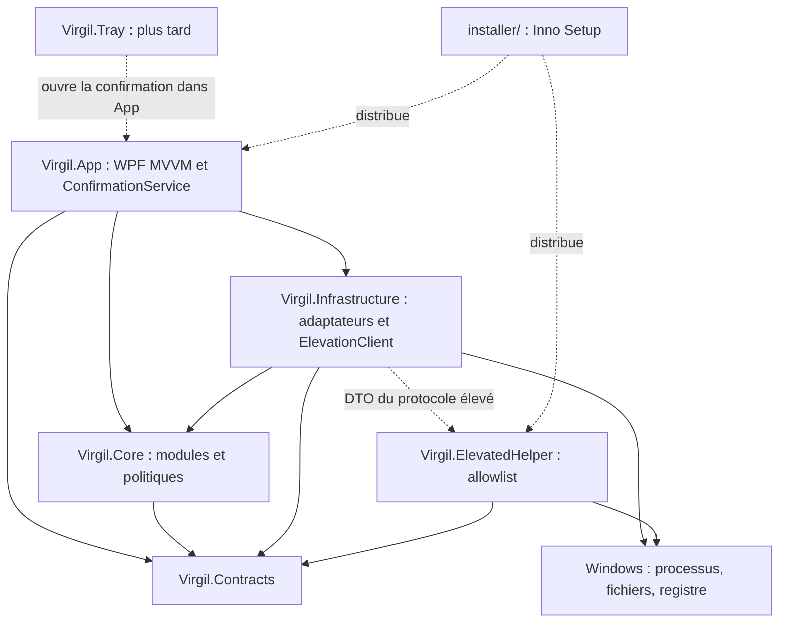

# Virgil 2.0 — Architecture

Ce document est la source de vérité pour l’architecture. Il distingue l’existant de la cible ; les documents de modules historiques ne prouvent pas qu’une capacité est livrée. La phase 0a ne modifie aucun code C# ni aucune dépendance.

## État actuel vérifié

La solution `Virgil.sln` contient cinq projets :

| Projet | Réalité du dépôt |
| --- | --- |
| `src/Virgil.App` | Application WPF .NET 8 Windows x64, fenêtre principale, vues Nettoyage, Mises à jour, Applications, Interventions, Ressources et Historique des rapports, contrôle animé Virgil. Logique dans le code-behind ; plusieurs vues et la fenêtre construisent directement leurs services. |
| `src/Virgil.Core` | Services de diagnostic, monitoring, ressources/processus, nettoyage, mises à jour winget/Windows, inventaire/désinstallation d’applications, interventions et rapports. Contient aussi les accès Windows, fichiers, registre, processus et le client du helper : la séparation métier/OS reste à faire. Référence Domain. |
| `src/Virgil.Domain` | Modèles de scan, santé système, nettoyage, mises à jour, applications, ressources, interventions/protocole élevé, rapports et animation. Plusieurs enums de risque propres aux modules. |
| `src/Virgil.ElevatedHelper` | Exécutable Windows séparé, requêtes/résultats via fichiers, validation du contexte et des chemins, allowlist de commandes, écriture atomique des résultats. Référence actuellement Core et Domain. |
| `tests/Virgil.Tests` | Tests xUnit : scan/règles, nettoyage et sécurité, mises à jour, applications/inventaire/désinstallation/résidus, ressources, interventions, rapports, protocole élevé et animation. Référence Core, Domain et ElevatedHelper. |

App référence Core et Domain ; sa référence au helper sert à sa construction/publication (`ReferenceOutputAssembly=false`). Le helper est publié avec App.

Les gardes existants incluent `CleanupPathGuard`, `CleanupSafetyClassifier`, `ProcessProtectionPolicy` et `ElevatedActionAllowlist`. Les confirmations sont encore spécifiques aux modules ; une surcharge de désinstallation prend notamment `bool userConfirmed`. Le nettoyage vérifie ses aperçus mais utilise encore `File.Delete` pour certains fichiers : la quarantaine généralisée n’est pas livrée. L’historique stocke déjà des rapports JSON locaux.

`Virgil.Contracts`, `Virgil.Infrastructure`, `Virgil.Tray` et `installer/` n’existent pas encore. Il n’existe pas de contrat commun `IMaintenanceModule`/`IMaintenanceAction`, de `ConfirmedPlan` commun, de `ConfirmationService` central, ni de composition via Hosting/CommunityToolkit.Mvvm ou de journalisation Serilog configurée. Les points de restauration et sauvegardes du démarrage décrits ci-dessous sont des exigences cibles.

La CI de référence est `.github/workflows/build.yml`, sur `windows-latest` : restore, build Release, tests, publication self-contained win-x64 et artefact. Elle ne produit pas encore d’installateur.

## Architecture cible

| Composant | Responsabilité et dépendances |
| --- | --- |
| `Virgil.Contracts` | Modèles partagés, contrat de module/action, résultats et DTO du protocole élevé. Aucune dépendance WPF, OS ou aux autres projets Virgil. |
| `Virgil.Core` | Logique des modules, orchestration et politiques de sécurité ; ports nécessaires au métier. Référence Contracts uniquement. Aucun appel OS direct. |
| `Virgil.Infrastructure` | Adaptateurs Windows, fichiers, registre, réseau et processus ; une seule abstraction `IProcessRunner` et son implémentation centralisée, sans runners concurrents par module. Logs Serilog dans `%APPDATA%\Virgil\logs`, settings JSON, stockage des rapports et `ElevationClient`. Référence Core et Contracts, implémente les ports. |
| `Virgil.App` | WPF MVVM avec CommunityToolkit.Mvvm ; composition DI via Microsoft.Extensions.Hosting. Vues minces, ViewModels injectés, `ConfirmationService` pour les interactions de consentement. Référence Contracts/Core et Infrastructure au point de composition. |
| `Virgil.ElevatedHelper` | Exécutable minimal privilégié. Parmi les projets Virgil, référence seulement Contracts ; conserve ses validations, son allowlist et son exécution locale strictement bornée. Ne charge ni Core, ni Infrastructure, ni App. |
| `Virgil.Tray` (plus tard) | Agent de barre des tâches, notifications et ouverture de l’application. N’agit jamais seul et ne contourne pas ConfirmationService. |
| `installer/` | Scripts Inno Setup pour distribuer App et le helper avec la publication self-contained. |

Les types utiles de Domain seront migrés vers Contracts ; Domain est transitoire, pas une couche supplémentaire de la cible. Les politiques restent dans Core, les effets Windows passent par Infrastructure. Le helper est la frontière privilégiée séparée : son exécuteur interne reste limité à l’allowlist, sans ouvrir un lanceur arbitraire.



Les flèches pleines entre projets représentent les dépendances ; les pointillés représentent les échanges ou la distribution.

## Contrat commun cible

Notation de contrat, à implémenter dans les phases suivantes (les opérations asynchrones acceptent un CancellationToken) :

```text
IMaintenanceModule
  Id, Title, Category
  ScanAsync -> Findings

IMaintenanceAction
  Id, RiskLevel, RequiresAdmin, RebootRequired, Reversibility
  PreviewAsync -> ActionPreview
  ExecuteAsync(ConfirmedPlan) -> ActionResult

RiskLevel = Info | Low | Sensitive | Critical
```

`Findings` décrit les constats et actions proposées sans modification du système. `ActionPreview` décrit précisément l’action, ses cibles, paramètres, effets, risques, droits, redémarrage, réversibilité et sauvegardes nécessaires. `ActionResult` décrit résultat, erreurs, effets réels et éléments de restauration. Une réversibilité partielle ou impossible doit être annoncée explicitement.

Un seul `RiskLevel` remplace les classifications divergentes. Il se mappe aux trois niveaux de popup :

| RiskLevel | Popup de confirmation |
| --- | --- |
| Info, Low | Niveau 1 : confirmation simple, effets et périmètre visibles. Un constat Info en lecture seule n’exige pas de popup d’exécution. |
| Sensitive | Niveau 2 : avertissement détaillé, conséquences et sauvegarde/restauration présentées, accord explicite. |
| Critical | Niveau 3 : confirmation renforcée avec saisie explicite liée à l’action et à sa cible. |

`RequiresAdmin` reste indépendant du risque ; l’UAC ne remplace pas le consentement dans Virgil.

## Confirmation liée à l’aperçu

Seul `ConfirmationService` peut créer un `ConfirmedPlan`, après l’accord explicite correspondant au risque. Un constructeur public ou la désérialisation d’un DTO ne doit pas permettre de fabriquer un consentement valide. Le plan porte l’identité de l’action, le hash d’une représentation canonique de l’aperçu (cibles, paramètres et conséquences compris), son émission et son expiration. La durée de validité est bornée et contrôlée avec une horloge testable.

`ExecuteAsync` valide le plan avant tout effet OS : provenance, identité, hash, expiration et conformité du périmètre aux conditions présentes. Un plan expiré, forgé, absent ou non conforme est refusé. Toute modification de sélection, de paramètres ou de cible invalide l’accord et impose un nouvel aperçu puis une nouvelle confirmation. Les préconditions et les gardes sont revérifiés au moment d’agir ; un refus ne produit aucun effet destructif.

Ce mécanisme remplace les paramètres `bool userConfirmed`, sans supprimer prématurément les confirmations et gardes actuels pendant la migration. Le protocole élevé transporte uniquement une requête bornée issue du plan validé ; le helper revérifie indépendamment identité, chemins, fraîcheur et allowlist. Le hash assure le lien avec l’aperçu, pas à lui seul l’authenticité d’une requête.

## Filets de sécurité obligatoires

- Nettoyer vers une quarantaine ou la corbeille, avec traçabilité et procédure de restauration. Ne pas basculer silencieusement en suppression définitive si ce mécanisme échoue ; toute purge irréversible est une action distincte avec aperçu et confirmation adaptés.
- Créer et vérifier un point de restauration avant les actions sensibles (`Sensitive` et `Critical`). En cas d’échec ou d’indisponibilité, bloquer l’action et expliquer le motif ; ne pas dégrader silencieusement la protection.
- Sauvegarder l’état du démarrage avant toute modification et fournir une restauration testée ; bloquer la modification si la sauvegarde échoue.
- Conserver ou renforcer `CleanupPathGuard`, `CleanupSafetyClassifier`, `ProcessProtectionPolicy` et l’allowlist du helper. Aucun texte libre du chat ne devient une commande OS arbitraire.
- Tester toute action destructive, y compris le refus d’un plan expiré/non conforme et l’absence d’effets après refus. Journaliser consentement, exécution, résultat et échec sans exposer de secrets.

## Migration

La [roadmap](ROADMAP.md) fixe les phases et leurs critères de sortie. La phase 0 construit les fondations sans nouvelle fonctionnalité ; la phase 1 migre Diagnostic et Nettoyage sur le contrat commun. Les capacités déjà présentes restent soumises à leurs protections tant que leur migration n’est pas validée. La présente documentation n’atteste ni l’implémentation de la cible ni un build réussi.
